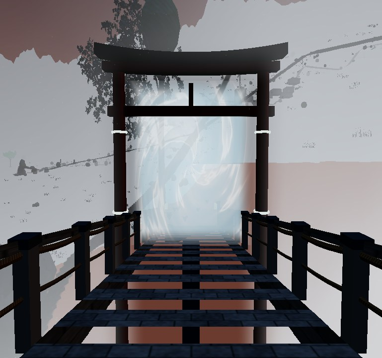
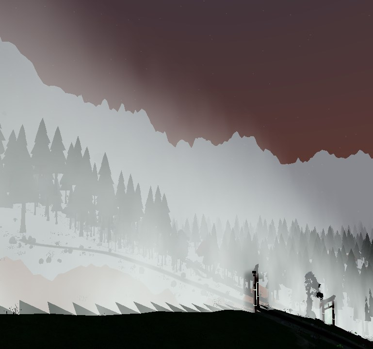

# Wolfveil area gates: go through a portal to reach the next area (2026-11-18)

Builds on [CLONE_WOLFVEIL_FIVE_AREA_PORTALS_PLATFORM_GRAPHICS_20261117.md](CLONE_WOLFVEIL_FIVE_AREA_PORTALS_PLATFORM_GRAPHICS_20261117.md),
the five-area loader with its portals, platform graphics settings and per-area terrain streaming. None of that is replaced.

Owner's brief: the land is divided into sections, only the section you are in is loaded, and
**"you have to go through the portal to load that other part of the land"**. The five-area loader already
loaded one area at a time. Its portals were decorative light arches, though, and a player could walk across
any border. This branch makes the portals the only way through.

## What changed

- **Spirit-veil walls** stand on every area border (`streaming/WolfveilAreaVeils.mjs`, `WolfveilAreaGates.js`):
  - Two 38 m mist sheets, tinted toward the area beyond the border as seen from the camera's side.
  - Each veil opens into an arch at every gate.
  - The veil thins when the camera is inside it.
  - All the veils are one mesh.
- **Collision (client, like buildings).** A move that crosses a border outside a gate opening is stopped, and the mover slides along the veil.
  - Applies to the player and both AI movement paths in `GameWorld3D.jsx`.
  - Off in a server-owned duel (`dedicatedMode`) and underground, because the cave tunnels pass under the borders.
  - The gate posts are solid.
- **Torii gates** replace the light arches at the same 11 portals from `WolfveilAreaPortalPlan.mjs`:
  - **Placement:** same positions, same deck and ground heights, same opening widths, so every portal path passes through its gate. On the bridges the posts run past the deck down to the ground.
  - **Look:** a vermilion torii with stone footings and rune bands in the two areas' colours.
  - **Membrane:** a swirling membrane fills each opening, tinted for the area on the other side.
  - **Label:** names the destination; its texture exists only while the camera is within 48 m.
  - **Cost:** four merged meshes for all gates, plus one membrane mesh.
- **Crossing mist** (`streaming/WolfveilAreaCrossingMist.js`). A screen mist thickens as the player steps into a gate and flashes when the area changes. The arrival title stays with `Game3DAreaNotice`, so there is one notice, not two.
- The area loader never manages any of this (`userData.wolfveilAreaShared`).

## Rollback

`WolfveilAreaPortals.js` (the light arches) is kept. In `GameWorld3D.jsx`, swap `createWolfveilAreaGates` back to
`createWolfveilAreaPortals` and the borders are open again. `areaPortals.setEnabled(false)` does the same at
runtime.

## Tests

`node --test tests/game3d-wolfveil-area-gates.test.mjs` runs 9 tests:
- veils separate exactly their two areas;
- one gate per portal, with the arch's opening;
- every portal path passes through its gate, both ways;
- the bridge gates span their decks;
- crossings anywhere else are blocked, with sliding;
- the T-junction corner is blocked;
- every area stays reachable;
- the visual module and its world-coordinate collision;
- the crossing mist;
- the GameWorld3D wiring.

The existing five-area tests (`tests/game3d-clone-wolfveil-five-area-loading.test.mjs`) pass unchanged.

## Live check (guest `/gameview`, `vite dev`)

This was a local merge of this branch with `claude/migration-repair-20261118`, the branch that re-wires the round-2
landscaping. The two branches merge without conflicts. In the running game:
- The town floor draws with the baked splat material.
- The baked rock field draws 1,252 rocks in 18 batches. The old path-edge stones are hidden in favour of the baked ones.
- All 53 plant-card meshes have their atlas.
- The gates and veils stand on their borders, and the light arches are gone.

These frames were rendered straight from the scene with no post effects, at the hidden browser pane's 769×720
size, so the aspect ratio is squeezed. The game's living ink style re-tints the torii from vermilion to ink.

## Known limitations

- **Not run signed in or on a phone.** Walking through a gate in the live game was not driven by real input. The veil collision is covered by tests, and was walked with collision in the earlier clone's harness.
- **Some trails stop at a veil.** The portal plan has no portal where a trail runs down the river channel (by design: only bridges cross the water). Those trails, for example the riverside loop by the waterfall, end at the veil; the bridges are the way across.
- **The server duel worker does not know about the veils** (client collision only), and NPC paths are not re-planned around them.

## Found while porting: round 2 landscaping is not switched on here

The migration (PR #70) copied the round-2 modules and assets, but not their wiring in `WolfveilScene.js`, which
conflicted with the per-area terrain streaming. So the following are present in this repository but not used:
- the baked terrain material and macro maps;
- the baked rock field and the conversion of path-edge stones to baked rock;
- the plant cards;
- live wind.

Wiring them into the area-streamed terrain is a separate change.
