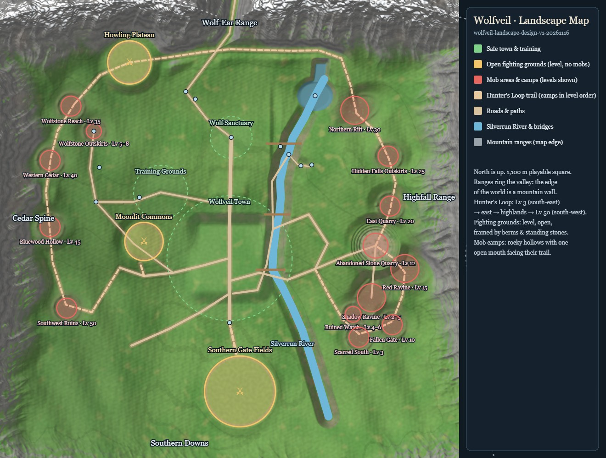

# Classic Wolfveil — whole-map landscape design (2026-11-16)

**Review branch `claude/landscape-whole-map-20261116`. Not merged, not deployed.**
Clone repository only (`marcusflow1-arch/gitsync-pro`); `atom-x-eve-os` is untouched.

Vector source: [WOLFVEIL_MAP_DESIGN_20261116.svg](WOLFVEIL_MAP_DESIGN_20261116.svg)
(regenerate with `node scripts/render-wolfveil-map.mjs`, ~40 s).

## 1. The map design

North is up; the playable square is the 1,100 m Classic Wolfveil core (Play
coordinates are local Z + 70 m). All shapes below come from one data module,
`src/components/game3d/wolfveil/WolfveilLandscapeDesign.mjs`, and the same data
drives the terrain height, the terrain colours, the HUD minimap, the world map
and this image.

| Layer | What it is |
|---|---|
| **Safe** (green) | Wolfveil Town (market + spawn), Shadow Wolf Training Grounds, Wolf Sanctuary. Heights unchanged. |
| **Open fighting grounds** (gold) | **Moonlit Commons** (beside town, on the Woodland Fork), **Southern Gate Fields** (wide battlefield south of the gate), **Howling Plateau** (mountain shelf under the Wolf-Ear peaks). Level (or gently tilted) turf, worn ring track, framing berm, standing stones, no monsters, no tall grass, no trees. |
| **Mob areas** (red) | The authoritative encounter data, not invented: 3 hostile zones (`WOLFVEIL_HOSTILE_ZONES`, Lv 2–8), 10 zombie camps (`WOLFVEIL_ZOMBIE_CAMPS`, Lv 3→50) and the quarry dragon. Each sits in a rocky hollow with a rubble rim, scorched ground and a single open mouth facing its trail, flanked by gateway boulders. |
| **Hunter's Loop** (dashed) | New graded trail that visits every camp in level order: Scarred South Lv 3 (south-east) → east side → Northern Rift Lv 30 → across the highlands → Wolfstone Reach Lv 35 → Cedar Spine → Southwest Ruins Lv 50. Cairns every ~55 m. |
| **Roads & paths** | The 10 existing `WOLFVEIL_ROUTES` (unchanged) + 5 frontier trails: Hunter's Loop ×3, Southern Fields Way, Commons Spur. |
| **River** | Silverrun River, existing course/levels/bridges unchanged; new water surface and banks. |
| **Mountain ranges** | Ring the valley so the edge of the world is a mountain wall: **Wolf-Ear Range** (north, twin ear spires, Ridge Path pass), **Cedar Spine** (west), **Highfall Range** (east), **Southern Downs** (south, with the river outlet gap). Beyond the edge: Snow Ridge, Far Cedar Peaks, Far Highfall Peaks, Southern Far Hills. |

## 2. How the land follows the design (per request)

1. **Minimap / world map** — `WolfveilMapDesign.mjs` converts the design to Play
   coordinates; `scripts/render-wolfveil-map.mjs` rasterises the *real* height
   and surface functions into `public/game3d/maps/wolfveil-landscape-v1.png`
   (hillshade + palette, north up). `hud/WolfveilMinimap.jsx` (player-centred
   radar in the compass) and `hud/WolfveilWorldMapLayers.jsx` (M map, whole
   valley, clickable fields/mob areas) draw it with roads, river, bridges,
   fighting grounds, mob levels, safe zones, landmarks and the zone name.
   `worldMapData.js` now charts the full 1,100 m valley for `wolfveil`.
2. **Grass** — the Ultra-Sumi streamed blades used a jade "flame" shader. New
   `meadow` profile (`BlazeGrassShaders.mjs`): every card draws a three-blade
   tuft (tapered curved blades, midrib, veins, root shade, per-tuft hue,
   sun-dried straws, backlit tips), wind bends tips, roots stay put. Card
   segments 16 → 6 (fewer triangles, same pinned 3× size). Floating ember
   sparks hidden. Owner grass meshes keep their own green (no jade tint).
3. **Paths** — `WolfveilTrailSurface.js`: procedural packed dirt with grit and
   pebbles mapped in world space (never stretched along a strip) plus a
   ragged, feathered verge (alpha map, standard material). Road beds
   (`gradeWolfveilRoadBeds`): tread levelled across its width, benched into
   slopes (cut uphill, fill downhill), shallow drainage swale; dirt shoulders
   in the terrain palette; grass systems keep off all trails.
4. **Mountains** — sculpted into the one shared heightfield: knife-edge crests,
   concave flanks, spurs, ridged couloirs, peaks/saddles, strata ledges; rock
   on steep faces, scree, snow above ~230 m on gentler ground. The streamed
   outer meadow continues the same surface past the edge (adaptive tile
   resolution + crack-hiding skirts). The 11 stacked cone meshes are gone; two
   fluted wolf-ear spires crown the Wolf-Ear summits.
5. **Riverbank** — smooth grass to the water line, dirt patches and dark rock
   spots right at the edge (palette), ~80 half-buried rock clusters. The river
   corridor and banks are masked from every new height change.
6. **Water** — `WolfveilSilverRiverMaterial.js`: the evenly spaced "glass
   ripple" crest train is replaced by a two-phase flow map (faster mid-channel,
   no stretching or stripes), wind ruffle, depth tint with a visible pebbly
   bed, sky Fresnel, sun glints, lace foam only at banks/cascades, feathered
   waterline. Same uniforms, contact ripples and material name.
7. **Directional landscaping** — trails sit in graded benches and passes;
   ranges ring the map; the Hunter's Loop leads camp to camp in level order
   with cairns on the skyline; fighting grounds read as level, framed arenas;
   camps read as rocky lairs with one mouth; colour language: lush green
   (meadow/safe), golden turf (fight), scorched/ashen (mobs), rock/snow
   (ranges), warm dirt (trails).

## 3. Protected — unchanged on purpose

- Heights of 23 authored anchors match `main` to < 0.1 mm (pinned test): town,
  spawn, gate, palace, sanctuary, 4 cave mouths + hub, hot spring, vortex
  lake, waterfall + cave, lunar/astral gates, all six bridge bearings.
- River course and water levels, bridges, caves, colliders, NPC spots, spawn
  data, quests, `WOLFVEIL_ROUTES`, tree anchors (`clearOf` unchanged).
- Server code is untouched; `server/game3d/mapCollision.mjs` imports the same
  `wolfveilHeight`, so its `WOLFVEIL_MAP_FINGERPRINT` changes automatically and
  old dedicated-duel map checkpoints are rejected by design.

## 4. Owner decisions touched (one-line rollbacks)

| Change | Rollback |
|---|---|
| Flame grass → natural meadow profile (size unchanged) | `blazeProfile:'sumi'` in `render/atomicUltraSumiMode.mjs` |
| West-half owner dirt/stone overlay now follows the design (trails, camps, riverbank dirt, forest floor) instead of ~80 % coverage; same owner textures | `landscape:false` for `addWolfveilWestHillsideLandscaping` in `WolfveilScene.js` |
| Outer meadow grass photo texture → the core's detail texture (it checkered the mountains) | revert `WolfveilLivingMeadow.js` material block |
| 11 cone ridge meshes removed in Game 3D (non-Game-3D path unchanged) | `addWolfEarPeaks(world)` without `landscape` |
| Empty radar → real minimap | `JadeSoulHUD.jsx` Compass |

## 5. Evidence

**Tests** (`node --test --test-reporter=tap tests/ server/game3d/tests/mapCollision.test.mjs`):
`main` eee8147 — 467 tests, 415 pass, 52 fail. Branch — 479 tests, 427 pass,
52 fail: the identical 52 failing tests (0 new, 0 fixed) plus 12 new passing
tests in `tests/game3d-clone-wolfveil-landscape-design.test.mjs` (anchors,
authoritative mob data, camp walkability, ranges + seamless edge, river
corridor, level fighting grounds, road-bed cross-slope, map data, water,
grass, wayfinding stones, no hidden cliffs).

**Lint**: ESLint on every changed file reports no error that is not already on
`main`; new files are clean (errors only). **Build**: `npm run build` fails on
`main` and on this branch with the same 3 pre-existing `MISSING_EXPORT` errors
in `social/EchoChronicleSkyAtlas.js` / `EchoChronicleJourneyTrail.js`.

**Screenshots** ([screenshots-20261116/](screenshots-20261116/)): 18 BEFORE/AFTER
game-camera and aerial pairs, the HUD minimap (cmp-19) and the world map
(cmp-20). Made with a local harness (not committed) that mounts the same
modules with the same options as `GameWorld3D` — Wolfveil village, living
meadow, imported town, vortex lake, gates, Ultra-Sumi grass, environment
system at 11:30 clear — once on an unmodified `main` worktree and once on
this branch. Game camera = Game 3D orbit (fov 50, distance 5.4, target
1.45 m); the red capsule stands in for the player; aerials have fog off so
the layout is visible. Not signed-in Base44 Play.

**Performance** (same views, same harness, main → branch):

| View | Draw calls | Triangles |
|---|---|---|
| Town spawn | 989 → 961 | 2.29 M → 1.97 M |
| Behind sanctuary | 238 → 222 | 3.57 M → 2.86 M |
| West path | 543 → 478 | 3.03 M → 2.01 M |
| River bridge | 505 → 511 | 2.58 M → 2.37 M |
| Hunter's Loop | 984 → 946 | 4.31 M → 2.52 M |

World build (`createWolfveilVillage`, Node, 2 runs): 2.0–2.3 s → 2.5–2.9 s
(+~0.5 s: heavier shared height function, +8.5 k trail triangles for the
frontier trails, landscape palette).

## 6. Known limitations / not verified

- Not run in signed-in Base44 Play, the hosted preview, multiplayer or mobile.
- The Luna palace sources are not in the clone (same before/after).
- Midday fog from the unchanged environment system softens distant ranges.
- Near the Ridge Path the pass is graded flat for 12 m on purpose (walkable).
- Fighting grounds are landscape design only: PvP rules are unchanged
  (duels remain the only PvP). Mob camps keep their existing spawn logic.
- After any terrain change, re-run `node scripts/render-wolfveil-map.mjs` so
  the minimap underlay matches.
- `.mjs` files get no browser/node globals in the clone's ESLint config
  (pre-existing); new Node files declare them.
